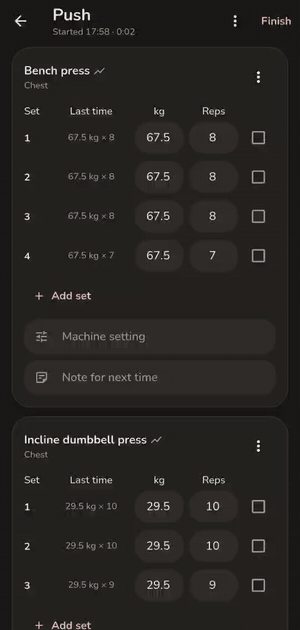
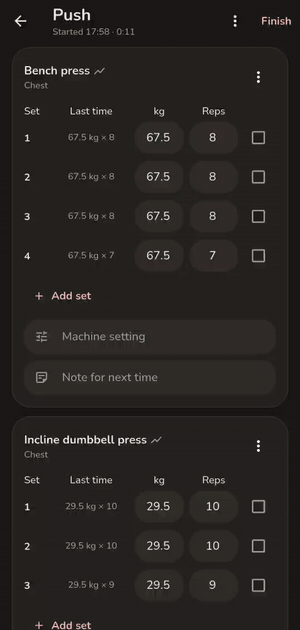
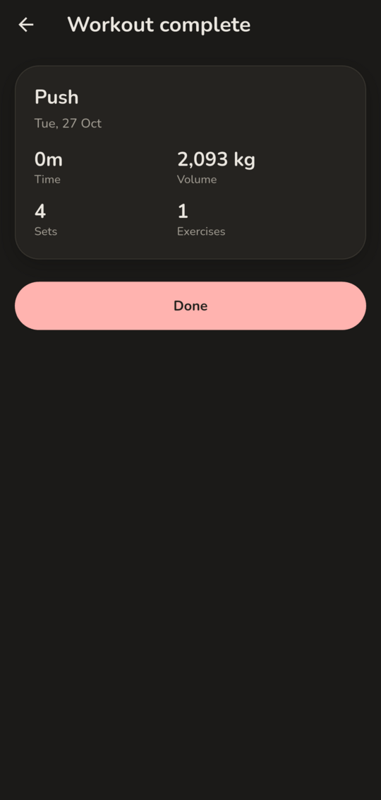

<p align="center">
  
</p>

<h1 align="center">tapIn</h1>

<p align="center">
  <b>Food and gym, in one app.</b><br />
  A private calorie, macro and workout tracker for Android. No account, no ads, no subscription.
</p>

<p align="center">
  <a href="LICENSE"></a>
  
  
  
</p>

<p align="center">
  <a href="#features">Features</a> ·
  <a href="#install">Install</a> ·
  <a href="#open-food-facts">Open Food Facts</a> ·
  <a href="#privacy">Privacy</a> ·
  <a href="#build-from-source">Build</a> ·
  <a href="#credits">Credits</a>
</p>

<p align="center">
  
  &nbsp;&nbsp;&nbsp;
  
</p>

<p align="center"><sub>Left: the five tabs. Right: logging a workout, with last time's numbers already filled in.</sub></p>

tapIn puts what you eat and how you train in one place. Log meals against a calorie and macro target, run your lifting plan from the same app, and see both on the same Home screen. Everything is saved on your phone, encrypted.

It is a fork of [OpenNutriTracker](https://github.com/simonoppowa/OpenNutriTracker) with a gym tracker, a redesigned look, and a set of changes to the food side. See [Credits](#credits).

## Screenshots

<table align="center">
  <tr>
    <td align="center" width="25%"></td>
    <td align="center" width="25%"></td>
    <td align="center" width="25%"></td>
    <td align="center" width="25%"></td>
  </tr>
  <tr>
    <td align="center"><sub><b>Home</b><br />the day at a glance</sub></td>
    <td align="center"><sub><b>Diary</b><br />every day you logged</sub></td>
    <td align="center"><sub><b>Gym</b><br />plans and weekly volume</sub></td>
    <td align="center"><sub><b>Trends</b><br />averages, streaks, goal</sub></td>
  </tr>
  <tr>
    <td align="center"></td>
    <td align="center"></td>
    <td align="center"></td>
    <td align="center"></td>
  </tr>
  <tr>
    <td align="center"><sub><b>Workout</b><br />what's in it</sub></td>
    <td align="center"><sub><b>Logging</b><br />last time beside each set</sub></td>
    <td align="center"><sub><b>Summary</b><br />volume and sets</sub></td>
    <td align="center"><sub><b>You</b><br />goal and body metrics</sub></td>
  </tr>
</table>

<sub>All screenshots use generated sample data, not a real person's log.</sub>

## Features

### Food

| | | |
| :--: | :-- | :-- |
| 🍎 | **Food logging** | Search the Open Food Facts database, scan a barcode, or quick-add calories. Search shows your own foods first, then the online results. |
| 🍽️ | **My foods** | Custom foods and recipes live together under one list. A recipe is a food made of ingredients, and a "New food" toggle covers both. |
| 📓 | **Diary** | Breakfast, lunch, dinner and snacks on a calendar. Entries show the amount the way you logged it, such as "1.5 servings", not only grams. |
| 🎯 | **Targets** | Type your calorie goal directly. Macros are three linked fields, in percent and grams, that rebalance together. |
| 📈 | **Trends** | 7 day to all-time views with the average calories next to the chart, surplus or deficit against goal, macro averages, protein per kg, weight, streaks and best and worst days. |
| 💧 | **Water and fasting** | Water tracking you can switch off in Settings, plus an optional fasting timer. |

### Gym

| | | |
| :--: | :-- | :-- |
| 📋 | **Workouts** | Build your own workouts and exercises. Tapping a workout shows what's in it, and Start begins logging. |
| ⚡ | **Fast logging** | Each set shows what you lifted last time. Tick it off, or change the weight and reps first. |
| 🛠️ | **Per-exercise details** | A machine setting, a note for next time, and an optional plate counter for barbell lifts. |
| ↕️ | **Flexible sessions** | Skip an exercise or a single set, reorder exercises, and edit a workout after you logged it. |
| 🧘 | **Rest days** | Log a rest day so a gap in the week is a choice you made, not a blank. Today's workout or rest day also shows on Home, above Breakfast. |
| 📊 | **Progress** | Per-exercise progress charts, weekly sets per muscle group, and a muscle filter. |
| 🔁 | **Import and export** | Your workouts, with settings, notes and plates, go in and out as JSON. |

### Everywhere

- A black-and-coral Material 3 look, with Material You colors available on Android 12+.
- Imports your data from OpenNutriTracker. See [Moving over from OpenNutriTracker](#moving-over-from-opennutritracker).
- Add products to Open Food Facts and correct wrong ones. See [Open Food Facts](#open-food-facts).

## Install

tapIn is not on an app store. Build the APK yourself (see [Build from source](#build-from-source)) and install it with `adb install` or by opening the file on your phone. It installs next to OpenNutriTracker under its own app id, `com.tapin.app`, and never touches that app's data.

## Open Food Facts

Food search and barcode scans use [Open Food Facts](https://world.openfoodfacts.org/), a free database run by volunteers. tapIn can also give back to it:

- **Add a missing product.** Scan a barcode that isn't found, tap **Add this product**, and enter what's on the package. If you're logged in you can then share it to Open Food Facts so the next person who scans it finds it.
- **Correct a wrong one.** Open a product that came from Open Food Facts and tap the flag in the top bar.

To do this, create a free account at [openfoodfacts.org](https://world.openfoodfacts.org/cgi/user.pl) and log in under **Settings → Data → Open Food Facts account**. Use your *username*, not your email.

Things worth knowing:

- Nothing is sent until you press Send on a form that shows you exactly what will be published. Implausible numbers (macros over 100 g per 100 g, sugars above carbs) are blocked first.
- Uploads are public, under your username, and become open data.
- Your password is stored encrypted on the phone and sent only to Open Food Facts, only when you log in or upload.
- An account does not raise the read limits. If scans say Open Food Facts is busy, that is rate limiting, and trying again in a minute usually works.

## Moving over from OpenNutriTracker

1. In OpenNutriTracker, open **Settings → Export / Import App Data → Export**.
2. Copy the zip to your phone, or open it from there.
3. In tapIn, open **Settings → Export / Import App Data → Import** and pick the file.

The two apps are separate installs, so your original data stays where it was. The export format is described in [`docs/export-format.md`](docs/export-format.md).

## Privacy

- **No account, no ads, no analytics.** Your diary, weight, water, fasting history, foods and workouts are stored on the phone in encrypted [Hive](https://pub.dev/packages/hive_ce) boxes, with the key held in the Android Keystore.
- **What leaves the phone:** food searches and barcode lookups to Open Food Facts (with a `tapIn/<version>` User-Agent), and anything you choose to upload there. Meal photos load from Open Food Facts when shown.
- **Optional, off by default:** AI meal entry, which uses an API key you supply, and crash reports, which are opt-in and have no endpoint configured in this build.
- **Export your data any time** as JSON, and import it again.

## Build from source

You need [Flutter](https://docs.flutter.dev/get-started/install) (the version pinned in `pubspec.yaml`) and the Android SDK.

```sh
git clone https://github.com/dakshhpanchal/tapIn
cd tapIn
cp .env.example .env            # or create .env with the keys the app reads
flutter pub get
flutter gen-l10n
flutter run --flavor full       # debug build on a connected phone
```

A release build for a 64-bit phone:

```sh
flutter build apk --release --flavor full --target-platform android-arm64
adb install -r build/app/outputs/flutter-apk/app-full-release.apk
```

Release signing reads `android/key.properties`, which is gitignored. Keep your keystore backed up, because Android will refuse updates signed with a different key.

**Try it with sample data.** The `develop` flavor is a separate app (`com.tapin.app.develop`) that wipes itself on every launch and fills in a year of demo food, a push/pull/legs plan and eight weeks of workouts. It never touches the real app's data. The screenshots above come from it:

```sh
flutter run --flavor develop -t lib/dev/main_dev.dart
```

Run the checks with `flutter analyze` and `flutter test`.

## Project layout

```
lib/
  core/        data sources, theme, shared widgets, DI (get_it)
  features/
    home/ diary/ trends/ profile/ settings/
    add_meal/ edit_meal/ meal_detail/ recipes/ scanner/
    gym/                  workouts, logging, progress, import/export
    off_account/          Open Food Facts login and uploads
    fasting/ onboarding/
  dev/         demo-data entry point, never reachable from a release build
test/          unit, bloc and widget tests
```

It follows OpenNutriTracker's clean-architecture split (data, domain, presentation) with `flutter_bloc` for state, `get_it` for dependency injection and encrypted `hive_ce` for storage. [AGENTS.md](AGENTS.md) has the conventions, and [CONTRIBUTING.md](CONTRIBUTING.md) has how to send changes.

## Credits

tapIn is built on [**OpenNutriTracker**](https://github.com/simonoppowa/OpenNutriTracker) by Simon Oppowa and its contributors, and keeps its GPL-3.0 license. Most of what makes the food side work comes from them.

Food data comes from [Open Food Facts](https://world.openfoodfacts.org/), available under the [ODbL](https://opendatacommons.org/licenses/odbl/). Charts use [fl_chart](https://pub.dev/packages/fl_chart).

## Disclaimer

> [!WARNING]
> tapIn is not a medical application. The numbers are estimates and food data is not validated, so use it with care. If you have a health condition, are ill, pregnant or breastfeeding, talk to a professional before changing how you eat or train.

> [!NOTE]
> tapIn is a personal project under active development. Expect rough edges.

## License

[GNU General Public License v3.0](LICENSE).
