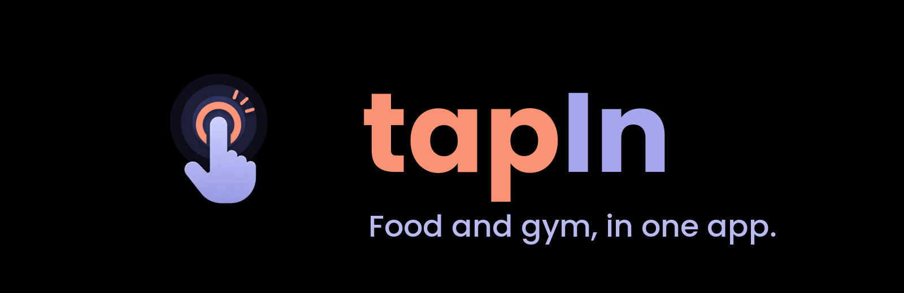
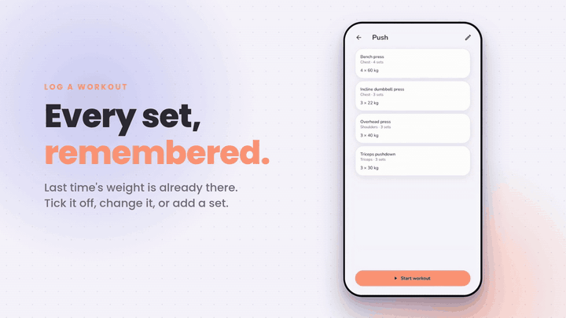
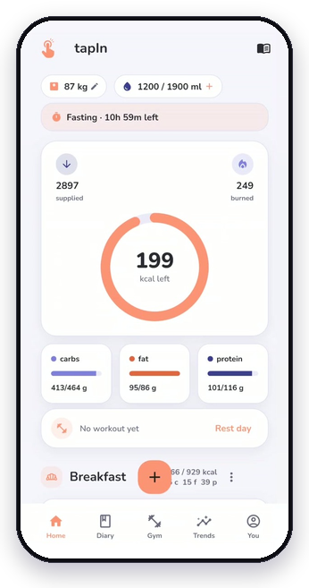
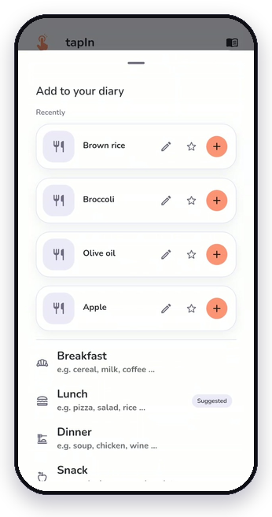
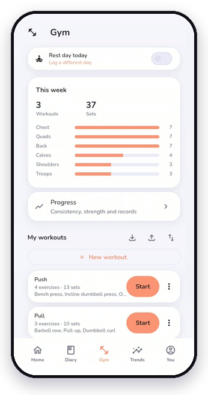
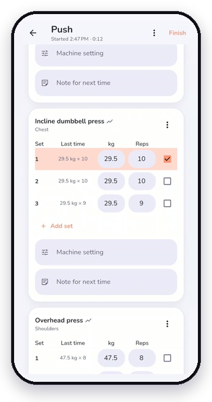
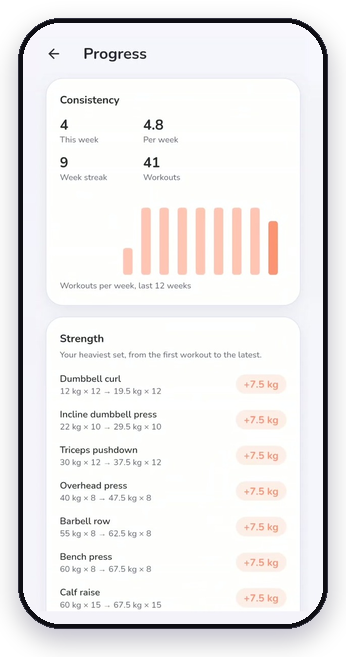
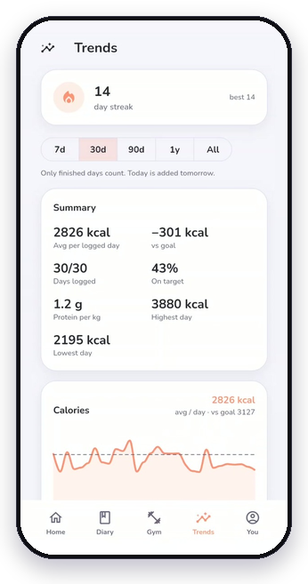
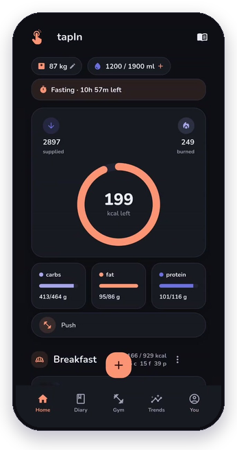
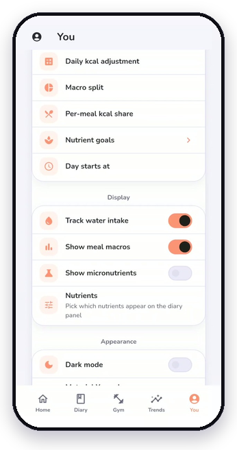

<p align="center">
  
</p>

<h3 align="center">Eat. Train. Track.</h3>

<p align="center">
  Calories, macros and workouts in one Android app.<br />
  No account, no ads, no subscription. Everything stays on your phone.
</p>

<p align="center">
  <a href="LICENSE"></a>
  
  
  
  <a href="https://github.com/dakshhpanchal/tapIn/stargazers"></a>
  <a href="https://github.com/dakshhpanchal/tapIn/issues"></a>
  <a href="https://github.com/dakshhpanchal/tapIn/pulls"></a>
</p>

<p align="center">
  <a href="#install">Install</a>
  &nbsp;·&nbsp;
  <a href="#a-look-around">A look around</a>
  &nbsp;·&nbsp;
  <a href="#features">Features</a>
  &nbsp;·&nbsp;
  <a href="#open-food-facts">Open Food Facts</a>
  &nbsp;·&nbsp;
  <a href="#build-from-source">Build</a>
  &nbsp;·&nbsp;
  <a href="CONTRIBUTING.md">Contributing</a>
</p>

<p align="center">
  
</p>

tapIn logs what you eat against a calorie and macro target worked out from your body and goal, and runs your lifting plan from the same app. Both show up on the same Home screen, and everything stays on your phone, encrypted. It is for anyone who wants to see the whole picture, food and training, without handing it to a company.

It is a fork of [OpenNutriTracker](https://github.com/simonoppowa/OpenNutriTracker) with a gym tracker, a redesigned look, and a set of changes to the food side. See [Credits](#credits).

## Install

Download the APK from the [latest release](https://github.com/dakshhpanchal/tapIn/releases/latest) and open it on your phone. Most phones need **arm64-v8a**; older 32-bit phones need **armeabi-v7a**. tapIn is not on an app store. Prefer to build it yourself? See [Build from source](#build-from-source).

It installs next to OpenNutriTracker under its own app id, `com.tapin.app`, and never touches that app's data. The release notes list the signing certificate's SHA-256 so you can check the file.

## A look around

<table align="center">
  <tr>
    <td align="center" width="25%"></td>
    <td align="center" width="25%"></td>
    <td align="center" width="25%"></td>
    <td align="center" width="25%"></td>
  </tr>
  <tr>
    <td align="center"><sub><b>Home</b><br />your day in one ring</sub></td>
    <td align="center"><sub><b>Add food</b><br />search, scan or create</sub></td>
    <td align="center"><sub><b>Gym</b><br />plans and weekly sets</sub></td>
    <td align="center"><sub><b>Log</b><br />last time, right there</sub></td>
  </tr>
  <tr>
    <td align="center"></td>
    <td align="center"></td>
    <td align="center"></td>
    <td align="center"></td>
  </tr>
  <tr>
    <td align="center"><sub><b>Progress</b><br />what you actually lifted</sub></td>
    <td align="center"><sub><b>Trends</b><br />finished days only</sub></td>
    <td align="center"><sub><b>Dark</b><br />easy on the eyes</sub></td>
    <td align="center"><sub><b>Yours</b><br />dark mode and colours</sub></td>
  </tr>
</table>

<p align="center"><sub>Screens show generated sample data, not a real person's log.</sub></p>

## Why tapIn

|  | |
| :-- | :-- |
| **One app** | Food, water, fasting and workouts in one place, so a heavy training day and a calorie target are on the same screen. |
| **Private** | No account to create. Your diary and workouts live in AES-256 encrypted storage with the key in the Android Keystore. No ads and no analytics SDKs. |
| **Quick** | Each set shows what you lifted last time, a barcode scan finds a food in a second, and re-logging something you ate is one tap. |
| **Portable** | Export everything as JSON and import it again. Your OpenNutriTracker data moves over in one step. |
| **Open** | GPL-3.0 and built on open data from Open Food Facts, which you can add to and correct from inside the app. |

## Features

### Food

| | | |
| :--: | :-- | :-- |
| 🍎 | **Food logging** | Search the Open Food Facts database, scan a barcode, or quick-add calories. Search shows your own foods first, then the online results. |
| 🍽️ | **My foods** | Custom foods and recipes live together under one list. A recipe is a food made of ingredients, and a "New food" toggle covers both. |
| 📓 | **Diary** | Breakfast, lunch, dinner and snacks on a calendar. Entries show the amount the way you logged it, such as "1.5 servings", not only grams. |
| 🎯 | **Targets** | Type your calorie goal directly. Macros are three linked fields, in percent and grams, that rebalance together. |
| 📈 | **Trends** | 7 day to all-time views with the average calories next to the chart, surplus or deficit against goal, macro averages, protein per kg, weight, streaks and best and worst days. Only finished days count, so today joins your averages tomorrow instead of dragging them down half-logged. |
| 💧 | **Water and fasting** | Water tracking you can switch off in Settings, plus an optional fasting timer. |

### Gym

| | | |
| :--: | :-- | :-- |
| 📋 | **Workouts** | Build your own workouts and exercises. Tapping a workout shows what's in it, and Start begins logging. |
| ⚡ | **Fast logging** | Each set shows what you lifted last time. Tick it off, or change the weight and reps first. |
| 🛠️ | **Per-exercise details** | A machine setting, a note for next time, and an optional plate counter for barbell lifts. |
| ↕️ | **Flexible sessions** | Skip an exercise or a single set, reorder exercises, and edit a workout after you logged it. |
| 🧘 | **Rest days** | Log a rest day so a gap in the week is a choice you made, not a blank. Today's workout or rest day also shows on Home, above Breakfast. |
| 📊 | **Progress** | Workouts per week and your week streak, each exercise's heaviest set from your first workout to the latest (weight × reps, no estimates), and your newest records. |
| 🔁 | **Import and export** | Your workouts, with settings, notes and plates, go in and out as JSON. |

### Everywhere

- A coral, lavender and indigo Material 3 look, taken from the app icon. **Dark mode** and **Material You colours** are two separate switches in Settings, so you can have either, both or neither.
- Imports your data from OpenNutriTracker. See [Moving over from OpenNutriTracker](#moving-over-from-opennutritracker).
- Add products to Open Food Facts and correct wrong ones. See [Open Food Facts](#open-food-facts).

## Open Food Facts

Food search and barcode scans use [Open Food Facts](https://world.openfoodfacts.org/), a free database run by volunteers. tapIn can also give back to it:

- **Add a missing product.** Scan a barcode that isn't found, tap **Add this product**, and enter what's on the package. If you're logged in you can then share it to Open Food Facts so the next person who scans it finds it.
- **Correct a wrong one.** Open a product that came from Open Food Facts and tap the flag in the top bar.

To do this, create a free account at [openfoodfacts.org](https://world.openfoodfacts.org/cgi/user.pl) and log in under **Settings → Data → Open Food Facts account**. Use your *username*, not your email.

Things worth knowing:

- Nothing is sent until you press Send on a form that shows you exactly what will be published. Implausible numbers (macros over 100 g per 100 g, sugars above carbs) are blocked first.
- Uploads are public, under your username, and become open data.
- Your password is stored encrypted on the phone and sent only to Open Food Facts, only when you log in or upload.
- An account does not raise the read limits. If scans say Open Food Facts is busy, that is rate limiting, and trying again in a minute usually works.

## Moving over from OpenNutriTracker

1. In OpenNutriTracker, open **Settings → Export / Import App Data → Export**.
2. Copy the zip to your phone, or open it from there.
3. In tapIn, open **Settings → Export / Import App Data → Import** and pick the file.

The two apps are separate installs, so your original data stays where it was. The export format is described in [`docs/export-format.md`](docs/export-format.md).

## Privacy

No account, no sign-in, no ads, no analytics. Your profile, diary, weight, water and fasting history, foods, recipes and workouts live in local [Hive](https://pub.dev/packages/hive_ce) boxes encrypted with AES-256, with the key held in the Android Keystore. You can export everything as JSON at any time and import it again.

**What leaves your device.** These destinations, nothing else, and the last two only if you turn them on, plus one more, set out below, if you point the app at a server of your own:

| Destination | When | What is sent |
| :-- | :-- | :-- |
| [Open Food Facts](https://world.openfoodfacts.org/) | Food search, barcode scan, whenever a food's photograph is shown, and when you log in or send a product | The search term or barcode. A word search also sends your device's **language** code to rank results; the barcode lookup sends no locale at all. Your **country is never sent**. Requests identify the app as `tapIn/<version>`. If you choose to share or correct a product, the product fields you reviewed, your username and your password, which is sent only for that request |
| [Anthropic](https://www.anthropic.com/) | **Only if you save your own API key and pick Anthropic** | The meal line you type on the multi-item add screen, or a meal photo you choose to read there, and your app language |
| [OpenAI](https://openai.com/) | **Only if you save your own API key and pick OpenAI** | As the Anthropic row, plus the model you chose |
| [OpenRouter](https://openrouter.ai/) | **Only if you save your own API key and pick OpenRouter** | As the Anthropic row, plus the model you chose |
| [Sentry](https://sentry.io) | **Only if you opt in, and only if a crash-report address is configured in the build** | Crash traces, app and OS version, device model |

**And one destination this project cannot name.** Every row above is a company with a published policy you can hold it to. If you point the app at a server you run, the destination is a machine of your choosing, so this row states a **rule** rather than a party.

| Destination | When | What is sent |
| :-- | :-- | :-- |
| **The address you entered, and nothing else** | **From the moment you type a server address in Settings, not from when you save it**: when you change the address and leave the field, when you press *Load models*, when you save (the setup check), and each time a meal line or photo is read | A models-list request when you change the address or press *Load models*; a fixed example line and a bundled photograph on save; otherwise the meal line or the photo, your app language, and the model name you typed |

This is the one row you can falsify yourself: your own server's access log settles it. **No third party receives anything on this path**, which is not the same as the data staying put. It does leave the device, to the address you named.

**AI meal assistance** is off until you supply your own API key, or the address of a server you run, in Settings. It is marked Experimental, which is a claim about stability rather than accuracy. The model reads *language*, not nutrition: it returns a food name and, when you stated one, an amount, and every calorie and macro still comes from the food database. [How it is built](docs/ai-architecture.md) walks a typed meal and a photo end to end.

**Permissions:** camera (barcode scanning, meal photos), photo library (meal photos, exports), notifications (daily reminder, fasting timer), and internet (food lookups).

## Build from source

You need [Flutter](https://docs.flutter.dev/get-started/install) (the version pinned in `pubspec.yaml`) and the Android SDK.

```sh
git clone https://github.com/dakshhpanchal/tapIn
cd tapIn
cp .env.example .env            # or create .env with the keys the app reads
flutter pub get
flutter gen-l10n
flutter run --flavor full       # debug build on a connected phone
```

A release build for a 64-bit phone:

```sh
flutter build apk --release --flavor full --target-platform android-arm64
adb install -r build/app/outputs/flutter-apk/app-full-release.apk
```

Release signing reads `android/key.properties`, which is gitignored. Keep your keystore backed up, because Android will refuse updates signed with a different key.

**Try it with sample data.** The `develop` flavor is a separate app (`com.tapin.app.develop`) that wipes itself on every launch and fills in a year of demo food, a push/pull/legs plan and eight weeks of workouts. It never touches the real app's data. The screenshots above come from it:

```sh
flutter run --flavor develop -t lib/dev/main_dev.dart
```

Run the checks with `flutter analyze` and `flutter test`.

## Project layout

```
lib/
  core/        data sources, theme, shared widgets, DI (get_it)
  features/
    home/ diary/ trends/ profile/ settings/
    add_meal/ edit_meal/ meal_detail/ recipes/ scanner/
    gym/                  workouts, logging, progress, import/export
    off_account/          Open Food Facts login and uploads
    fasting/ onboarding/
  dev/         demo-data entry point, never reachable from a release build
test/          unit, bloc and widget tests
```

It follows OpenNutriTracker's clean-architecture split (data, domain, presentation) with `flutter_bloc` for state, `get_it` for dependency injection and encrypted `hive_ce` for storage. [AGENTS.md](AGENTS.md) has the conventions, and [CONTRIBUTING.md](CONTRIBUTING.md) has how to send changes.

## Credits

tapIn is built on [**OpenNutriTracker**](https://github.com/simonoppowa/OpenNutriTracker) by Simon Oppowa and its contributors, and keeps its GPL-3.0 license. Most of what makes the food side work comes from them.

Food data comes from [Open Food Facts](https://world.openfoodfacts.org/), available under the [ODbL](https://opendatacommons.org/licenses/odbl/). Charts use [fl_chart](https://pub.dev/packages/fl_chart).

## Disclaimer

> [!WARNING]
> tapIn is not a medical application. The numbers are estimates and food data is not validated, so use it with care. If you have a health condition, are ill, pregnant or breastfeeding, talk to a professional before changing how you eat or train.

> [!NOTE]
> tapIn is a personal project under active development. Expect rough edges.

## License

[GNU General Public License v3.0](LICENSE).
